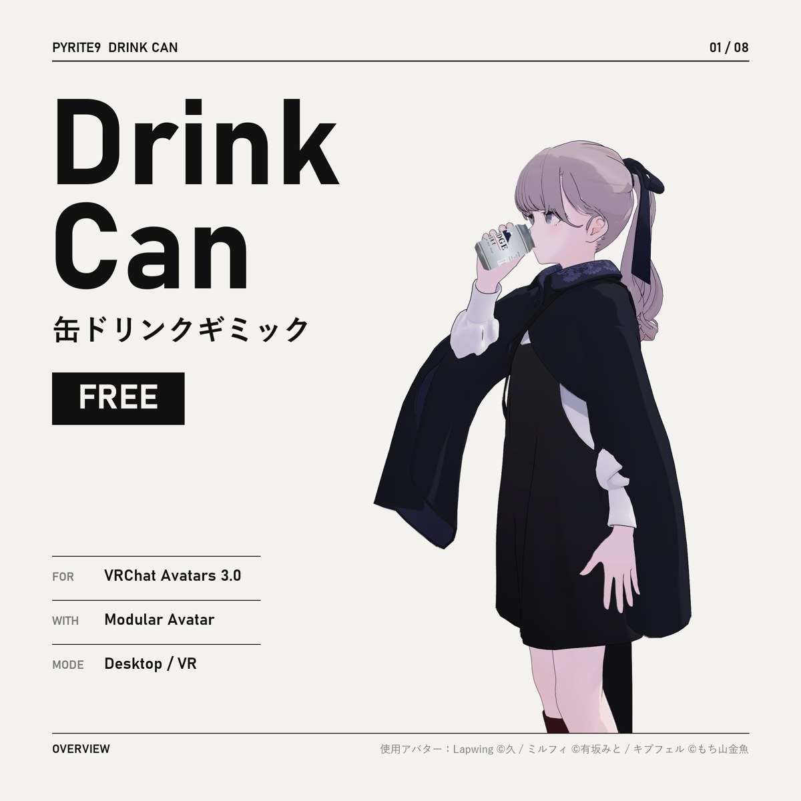
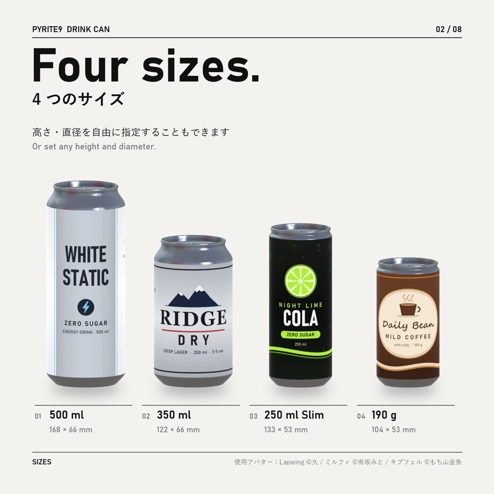
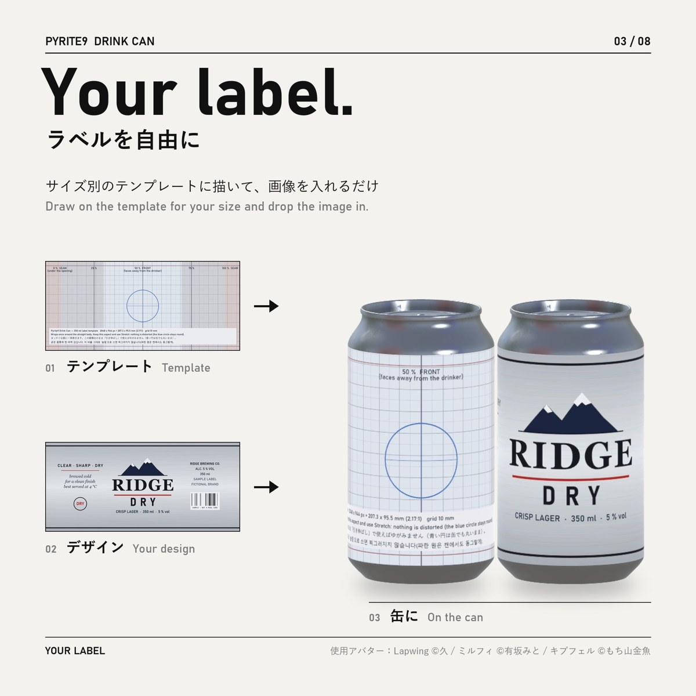
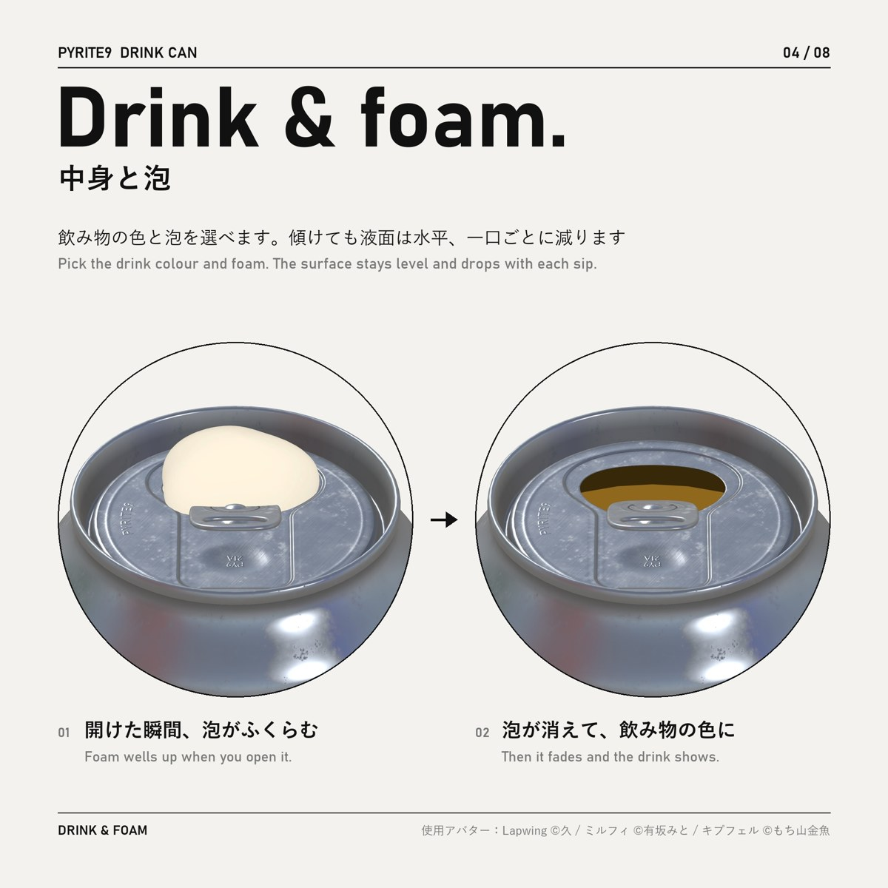
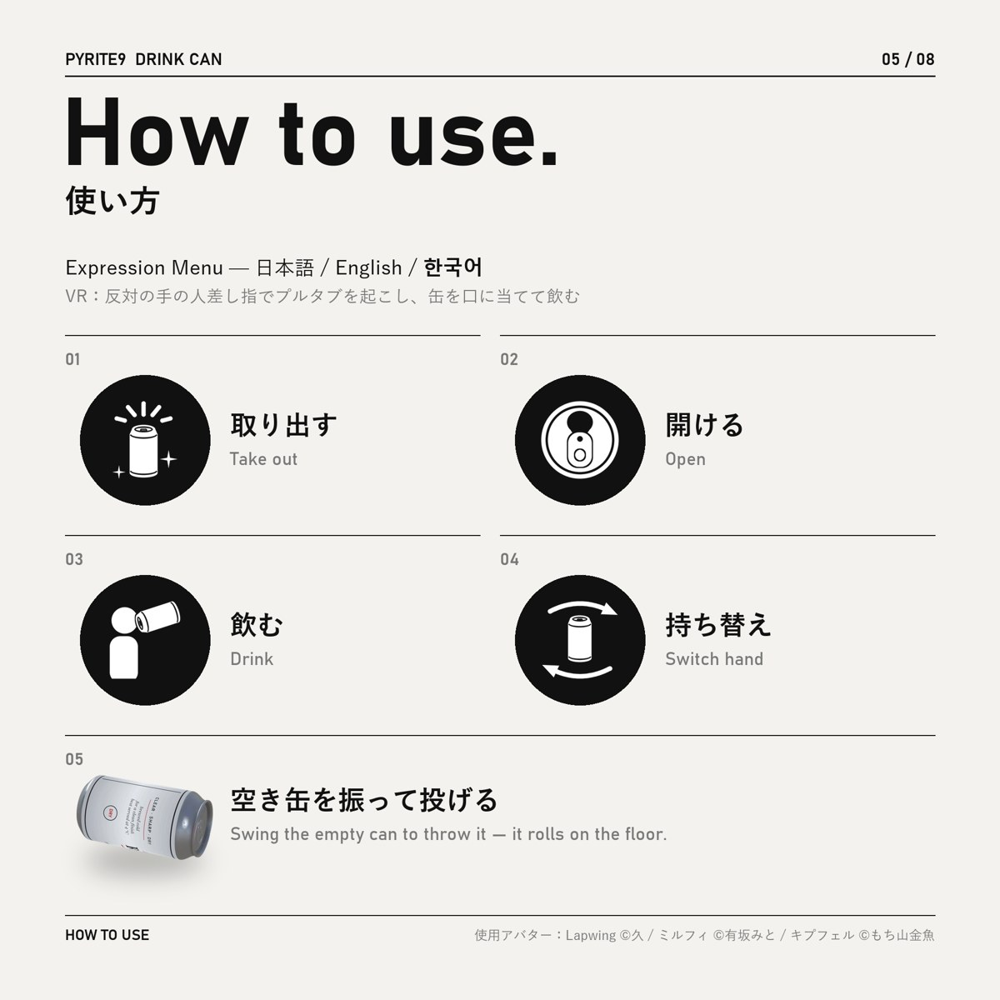
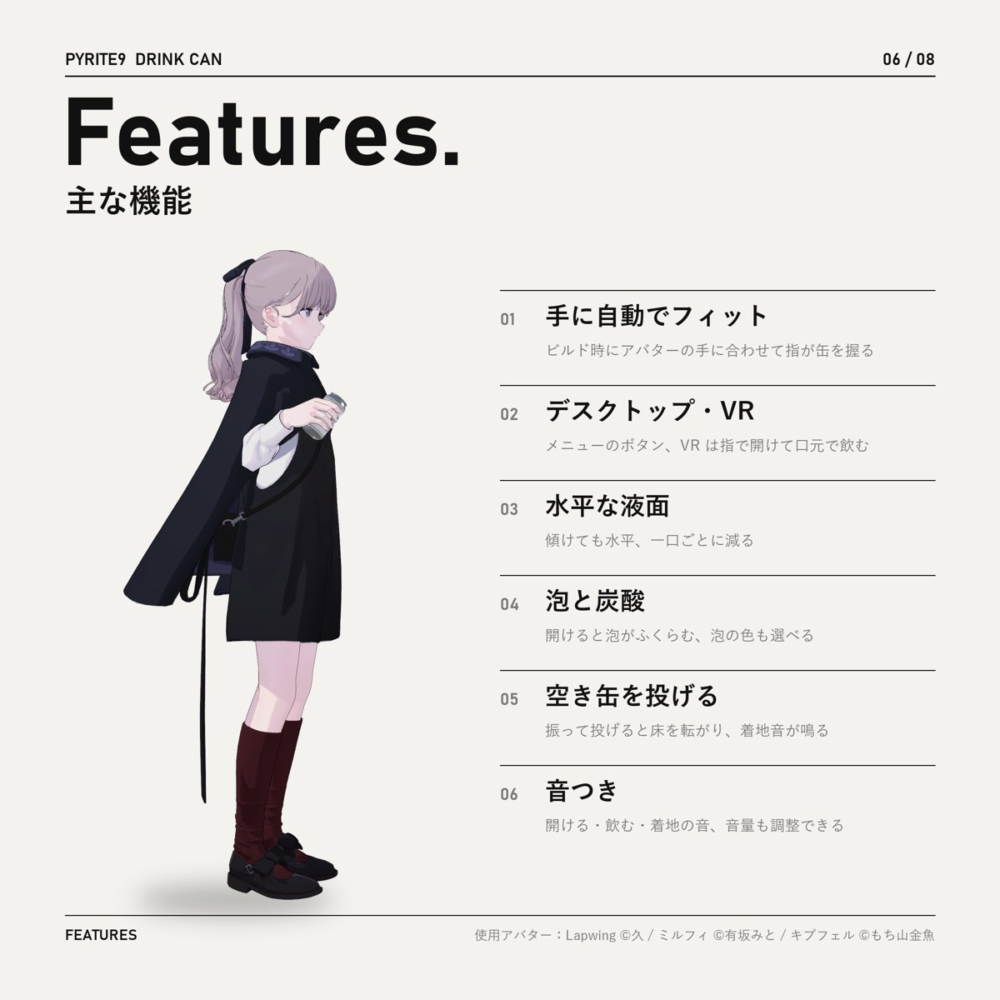
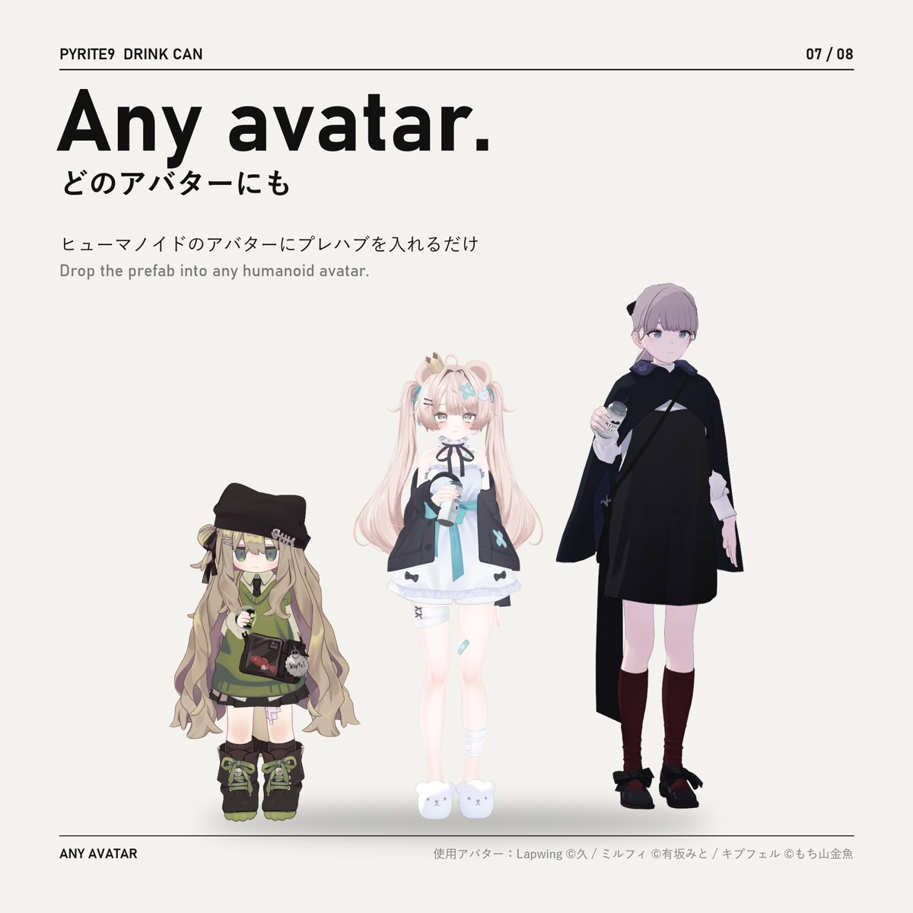
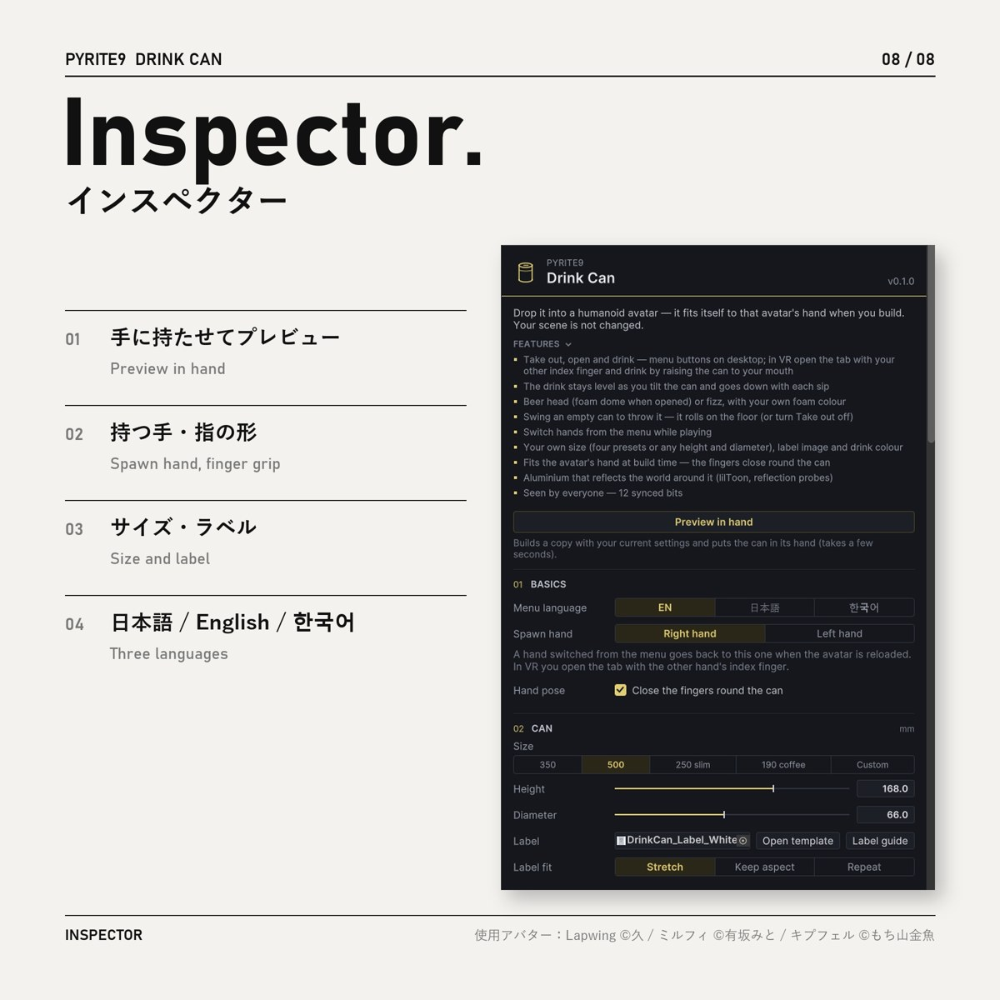

  

<h1 align="center">Drink Can</h1>

  <b>缶ドリンクギミック</b> · Drink can gimmick for VRChat · VRChat 음료 캔 기믹 
  <b>FREE / 無料 / 무료</b> — Modular Avatar · Desktop / VR

  <a href="https://pyrite9.booth.pm/items/9038058"><b>BOOTH</b></a> ·
  <a href="../../releases/latest"><b>Download (Releases)</b></a> ·
  <a href="https://youtu.be/X1OVrH2HJMI"><b>Video</b></a> ·
  <a href="Assets/Pyrite9/DrinkCan/README_jp.md">日本語</a> ·
  <a href="Assets/Pyrite9/DrinkCan/README_en.md">English</a> ·
  <a href="Assets/Pyrite9/DrinkCan/README_ko.md">한국어</a>

---

`02 / 08`

## Four sizes.

4 つのサイズ — 高さ・直径を自由に指定することもできます  
Four presets, or any height and diameter.  
네 가지 크기 — 높이·지름을 직접 정할 수도 있습니다

---

`03 / 08`

## Your label.

サイズ別のテンプレートに描いて、画像を入れるだけ  
Draw on the template for your size and drop the image in.  
크기별 템플릿에 그리고 이미지를 넣기만 하면 됩니다

---

`04 / 08`

## Drink & foam.

飲み物の色と泡を選べます。傾けても液面は水平、一口ごとに減ります  
Pick the drink colour and foam. The surface stays level and drops with each sip.  
음료 색과 거품을 고를 수 있습니다. 기울여도 수면은 수평, 한 모금마다 줄어듭니다

---

`05 / 08`

## How to use.

取り出す・開ける・飲む・持ち替え — 空き缶は振って投げる（VR は反対の手の人差し指でプルタブを起こし、缶を口に当てて飲む）  
Take out, open, drink, switch hand — swing the empty can to throw it (in VR, open the tab with the other hand's index finger and raise the can to your mouth).  
꺼내기·따기·마시기·손 바꾸기 — 빈 캔은 휘둘러 던지기(VR은 반대 손 검지로 탭을 따고, 캔을 입에 대고 마심)

---

`06 / 08`

## Features.

---

`07 – 08 / 08`

## Any avatar. · Inspector.

ヒューマノイドのアバターにプレハブを入れるだけ — ビルド時に手に合わせて自動調整  
Drop the prefab into any humanoid avatar — it fits the hand at build time.  
휴머노이드 아바타에 프리팹을 넣기만 하면 — 빌드할 때 손에 맞춰 자동 조정

  
  

---

## Install. / 導入 / 설치

1. VCC / ALCOM で **Modular Avatar** と **lilToon** を追加 · Add Modular Avatar and lilToon · Modular Avatar와 lilToon 추가
2. `Pyrite9_DrinkCan_v*.unitypackage` をインポート · Import the unitypackage · unitypackage 임포트
   (or copy `Assets/Pyrite9/DrinkCan/` from this repository with the `.meta` files)
3. `Assets/Pyrite9/DrinkCan/DrinkCan.prefab` をアバターの中へドラッグ · Drag the prefab into your avatar · 프리팹을 아바타 안으로 드래그
4. Build & Test → Build & Publish

## Requirements. / 動作環境 / 필요한 것

Unity 2022.3 · VRChat SDK Avatars 3.10+ · Modular Avatar (NDMF) · lilToon 2.x · humanoid avatar  
Tested: Unity 2022.3.22f1 / VRChat SDK 3.10.5 / Modular Avatar 1.18.7 / NDMF 1.14.8 / lilToon 2.3.4, 2.4.1  
The inspector checks GitHub (`api.github.com`) for the latest version once a day; nothing is sent. · インスペクターは 1 日 1 回 GitHub で最新版を確認します（送信する情報はありません）· 인스펙터는 하루 한 번 GitHub에서 최신 버전을 확인합니다(보내는 정보 없음)

## License. / 利用規約 / 라이선스

Free — not an open-source license. See [LICENSE.txt](LICENSE.txt) (English / 日本語 / 한국어).  
Avatars using it (public or private) and monetized videos / streams are fine. Viewing and forking on GitHub are fine; redistributing the files elsewhere is not.  
無料。アバターへの使用・収益化を含む動画/配信 OK。GitHub での閲覧・フォーク可、それ以外での再配布は不可。  
무료. 아바타 사용·수익 창출 포함 영상/방송 OK. GitHub에서 보기·포크 가능, 그 밖의 재배포는 불가.

Sounds and aluminium textures are derived from CC0 works (`Sounds/CREDITS.txt`, `Textures/THIRD_PARTY.txt`).

使用アバター（画像）: Lapwing ©久 / ミルフィ ©有坂みと / キプフェル ©もち山金魚

© Pyrite9

